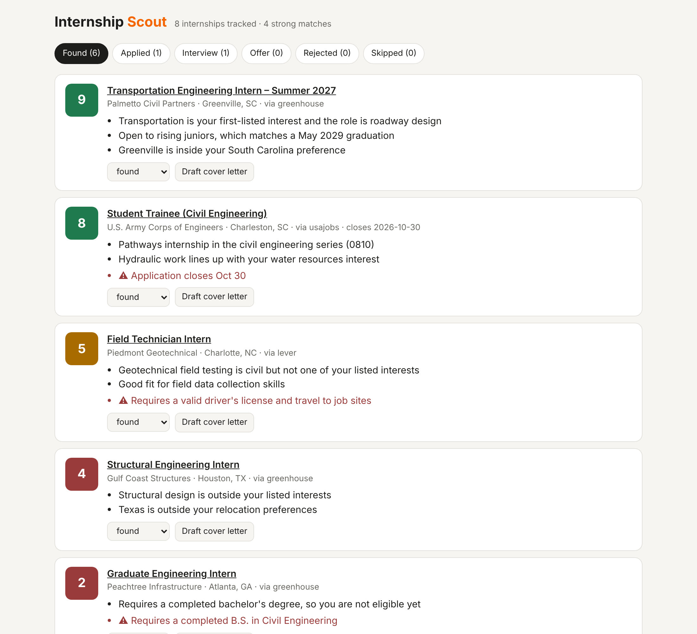

# Internship Scout

A daily agent that finds civil engineering internships and co-ops, scores each one against my resume with Claude, sends the strong matches to my phone, and tracks every application from "found" to "offer".



*Screenshot from demo mode. The companies and postings shown are made up.*

## What it does

1. **Collects postings** every morning from company job boards (Greenhouse and Lever public APIs) and federal jobs on USAJOBS, such as Army Corps of Engineers Pathways internships.
2. **Cleans them up.** Every source is converted into one format, a keyword filter keeps only civil internships and co-ops, and duplicates (the same internship on two boards, or re-posted with a new year in the title) are merged.
3. **Scores each posting from 1 to 10** against a structured version of my resume using Claude Haiku. The scorer follows a written rubric, checks eligibility first (class standing, degree requirements), and must answer in a fixed JSON shape: score, reasons, and red flags.
4. **Alerts me** with one phone notification per day listing new postings that scored 7 or higher.
5. **Tracks applications** on a password-protected page: found → applied → interview → offer / rejected.
6. **Drafts cover letters** on request with Claude Sonnet. The letter may only use facts from my resume, so it never invents experience. It never submits anything; I review and send every application myself.

## How it's built

| Part | Tool |
|---|---|
| Hosting and daily schedule | Cloudflare Workers + cron trigger |
| Database | Cloudflare D1 (SQLite) |
| Scoring | Claude Haiku 5.5 with structured JSON output |
| Cover letters | Claude Sonnet 5.5 |
| Phone alerts | [ntfy](https://ntfy.sh) |
| Language | TypeScript, tested with Vitest |

```
src/
  sources/      one fetcher per job board, each returning the same Posting shape
  pipeline/     filter.ts (is it a civil internship?), dedupe.ts, run.ts (the daily job)
  scoring/      rubric.ts (the instructions), score.ts (the Claude call), resume.ts (resume format)
  letters/      cover letter drafts
  ui/page.ts    the tracker page
  index.ts      web routes + the cron entry point
migrations/     database tables
eval/           checks the scorer against my own hand scores
```

## Keeping the AI scores honest

An AI score is only useful if it agrees with my own judgment and gives the same answer twice. `npm run eval` takes postings I scored by hand, scores each one twice with the model, and reports:

- average distance between the model's score and mine
- how often it lands within 1 point of mine
- how often it makes the same "alert or not" call (7+)
- run-to-run drift between the two model scores
- the five postings where we disagree most, which is where the rubric needs work

## Run it yourself

You need Node 20+ and a free Cloudflare account.

```bash
npm install
npm test            # unit tests for the parsers, filter and dedupe
npm run demo        # local demo with sample data at http://localhost:8787 (password: demo)
```

For the demo, first create a `.dev.vars` file containing `APP_PASSWORD=demo`.

To deploy for real:

```bash
npx wrangler d1 create internship-scout       # paste the id into wrangler.toml
npx wrangler d1 migrations apply internship-scout --remote
npm run discover                              # finds which firms use Greenhouse or Lever
npx wrangler secret put ANTHROPIC_API_KEY
npx wrangler secret put APP_PASSWORD
npx wrangler secret put USAJOBS_API_KEY       # free: developer.usajobs.gov
npx wrangler secret put USAJOBS_EMAIL
npx wrangler secret put NTFY_TOPIC            # any hard-to-guess name; subscribe to it in the ntfy app
npm run deploy

# Upload your resume (copy config/resume.example.json to config/resume.json and fill it in)
curl -u me:YOUR_PASSWORD -X PUT --data @config/resume.json https://<your-worker>.workers.dev/api/resume
# Run once now instead of waiting for tomorrow's cron
curl -u me:YOUR_PASSWORD -X POST https://<your-worker>.workers.dev/api/run
```

## Cost

The job boards are free. Scoring a few hundred postings a month with Haiku costs well under a dollar, and each cover letter costs a few cents. Each run scores at most 25 new postings to keep the bill predictable.

## Rules it follows

- Uses only public job-board APIs and the official USAJOBS API. No scraping.
- Never submits an application.
- Cover letters use only facts from the resume.
